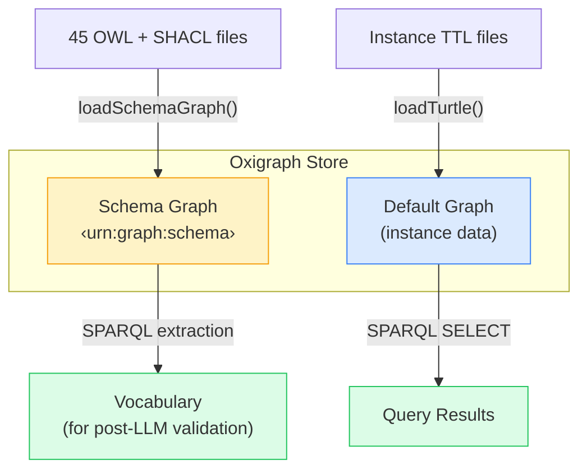

# Data Model

Sample datasets and the knowledge graph structure.

## Dual Graph Architecture

The system uses a single Oxigraph store with **two named graphs**:



### Schema Graph (`<urn:graph:schema>`)

Contains the **ontology definitions** — OWL class hierarchies, SHACL shapes with `sh:in` value constraints, property definitions. Raw SHACL files are read directly for the LLM prompt (via SHACL reader), and `schema-queries.ts` runs SPARQL against this graph to derive asset domains, domain references, shape groups, and other compiler metadata.

### Default Graph (instance data)

Contains **358 simulation assets** — the actual data that users search (exact counts track the sample TTL files and may shift as they evolve):

| Asset Type         | Count | Example Properties                                |
| ------------------ | :---: | ------------------------------------------------- |
| HD Maps            |  165  | roadTypes, laneCount, formatType, country, length |
| Environment Models |  70   | terrainType, vegetationType, weatherCondition     |
| OSI Traces         |  53   | roadTypes, granularity, fileFormat, numberFrames  |
| Scenarios          |  50   | scenarioCategory, weather, timeOfDay              |
| Surface Models     |  20   | materialType, frictionCoefficient, textureFormat  |

## RDF Structure

Each asset in the demo dataset follows the ENVITED-X pattern:

```turtle
# An HD Map asset
<did:web:provider35.net:HdMap:karlsruhe-parking-garage-001> a hdmap:HdMap ;
  rdfs:label "Karlsruhe Parking Garage HD Map"@en ;
  hdmap:hasResourceDescription [
    a envited-x:ResourceDescription ;
    schema:name "Karlsruhe Parking Garage HD Map" ;
    gx:license "CC0-1.0"
  ] ;
  hdmap:hasDomainSpecification [
    a hdmap:DomainSpecification ;
    hdmap:hasContent [
      a hdmap:Content ;
      hdmap:roadTypes "custom" ;
      hdmap:laneCount 3 ;
      hdmap:trafficDirection "right-hand"
    ] ;
    hdmap:hasFormat [
      a hdmap:Format ;
      hdmap:formatType "Lanelet2"
    ] ;
    hdmap:hasGeoreference [
      a georeference:Georeference ;
      georeference:hasProjectLocation [
        a georeference:ProjectLocation ;
        georeference:country "DE" ;
        georeference:region "Baden-Wuerttemberg"
      ]
    ]
  ] .
```

## Dataset Sources

Ontology schema files are resolved from `ontology-sources.json`. Runtime sample instance data is loaded by `packages/search/src/data-loader.ts`, which **prefers JSON-LD** files and falls back to the equivalent Turtle, from `packages/search/data/`:

- `sample-hdmap.jsonld` — HD maps
- `sample-scenarios.jsonld` — scenarios (each embedding the HD maps and environment models it references)
- `sample-ositrace.jsonld` — OSI traces
- `sample-environment-models.jsonld` — environment models
- `sample-surface-models.jsonld` — surface models
- `sample-openlabel.jsonld` — standalone OpenLABEL V1-0-0 tags (`openlabel:Tag` documents not attached to any asset), one per functional driving situation; exercises the standalone-vocabulary `UNION` arm

Because the scenario file embeds the assets it references, the loaded store reports more HD maps (165) and environment models (70) than the standalone HD-map and environment-model files contain. Parallel `.ttl` files are kept as a fallback for environments without JSON-LD support; they carry no OpenLABEL content.

### OpenLABEL sample data

Every `openlabel:*` node in the sample files is owned by one script, `scripts/generate-openlabel-sample-data.mjs` (`--check` fails on drift; `pnpm run test:scripts` runs it). It rewrites **only** the OpenLABEL nodes of the other sample files — the general generator `generate-sample-data.mjs` (which no longer emits any OpenLABEL content) has drifted from the committed files (for example it emits `gx:name` where the files hold `schema:name`), so a full regeneration would rewrite thousands of unrelated lines.

The content comes from a catalogue of 44 functional situations in `scripts/openlabel-situations.mjs`: 38 motorway situations inspired by the families of automated lane keeping (nominal following, lead-vehicle braking and cut-out reveals, cut-in and merging, stationary and crossing road users, environment and perception disturbances, ODD boundaries, emergency behaviour, traffic rules) and 6 non-motorway _contrast_ situations that must not match motorway queries. They are expressed in what OpenLABEL V1-0-0 can say — ODD attributes, behaviour flags, road users. Driver state, system faults, transition demands and lateral wandering within a lane have no v1 tag and are deliberately absent.

| Where                                                                   | What it holds                                                                                                                                                                                                                                                                                                                                                               |
| ----------------------------------------------------------------------- | --------------------------------------------------------------------------------------------------------------------------------------------------------------------------------------------------------------------------------------------------------------------------------------------------------------------------------------------------------------------------- |
| `sample-openlabel.jsonld`                                               | one `openlabel:Tag` per situation: `AdminTag`, `Odd` (all categories), `Behaviour`, `RoadUser`                                                                                                                                                                                                                                                                              |
| HD maps (`sample-hdmap.jsonld`, and those in `sample-scenarios.jsonld`) | one `openlabel:OddScenery` content node per HD map — scenery attributes only: the road type, lane types and travel direction the map's own content states (`roadTypes`, `laneTypes`, `trafficDirection`), plus a situation's scenery, which wins where both say something; motorway/highway maps draw from the motorway situations, other maps from the contrast situations |
| scenarios (`sample-scenarios.jsonld`)                                   | separate `OddEnvironment`, `OddDynamicElements`, `Behaviour` and `RoadUser` content nodes per scenario (the scenery lives in the referenced HD map) — the shape of OMB's own valid scenario instance; drawn from the motorway situations when every HD map the scenario references is motorway-like, from the contrast situations otherwise                                 |
| ositrace, environment-model, surface-model sample files                 | no OpenLABEL — their shapes allow exactly one `hasContent` item (`sh:maxCount 1`) and name no OpenLABEL alternative                                                                                                                                                                                                                                                         |

Validity is checked twice: `packages/search/src/__tests__/openlabel-sample-conformance.test.ts` validates the data as loaded into the store against the v1 shapes (SHACL Core, with negative controls proving the check is not vacuous), and OMB's reference validator agrees (`onto-validate --run check-data-conformance`, pyshacl with RDFS inference). `openlabel-v1-scenarios.test.ts` then compiles one query per situation family and compares the result with an oracle that reads the JSON-LD directly. See [OpenLABEL: v1 vs. v2](/ontology#openlabel-v1-vs-v2) for why v1 data needs this care.

## SPARQL Store Abstraction

The `SparqlStore` interface decouples the application from any specific triplestore:

```typescript
interface SparqlStore {
  query(sparql: string): Promise<SparqlResults>
  update(sparql: string): Promise<void>
  loadTurtle(data: string, graphUri?: string): Promise<void>
  loadJsonLd(data: string, graphUri?: string): Promise<void>
  isReady(): Promise<boolean>
}
```

| Implementation        | Description                                      |
| --------------------- | ------------------------------------------------ |
| **OxigraphStore**     | WASM-based, runs in-process, zero infrastructure |
| **RemoteSparqlStore** | HTTP client for any SPARQL 1.1 endpoint          |
| **CachedSparqlStore** | LRU query cache decorator (wraps either)         |

## Query Results

SPARQL SELECT queries return bindings as key-value pairs, streamed via SSE:

```json
[
  {
    "asset": "manifest:asset-autobahn-a9",
    "name": "Autobahn A9 Munich-Nuremberg",
    "roadTypes": "motorway",
    "country": "DE"
  },
  {
    "asset": "manifest:asset-i95",
    "name": "US Interstate I-95 Section",
    "roadTypes": "interstate",
    "country": "US"
  }
]
```
