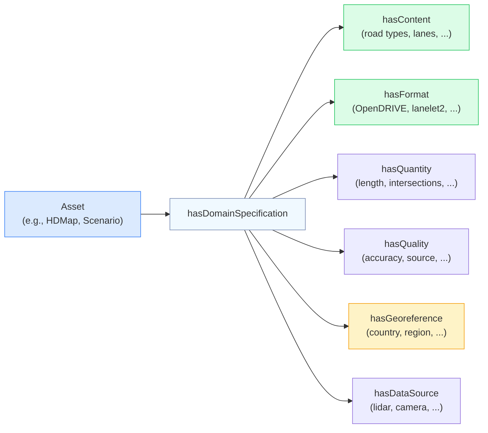
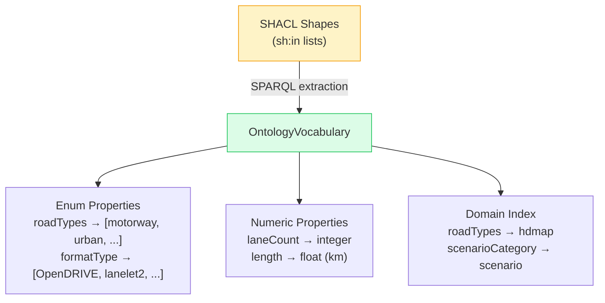
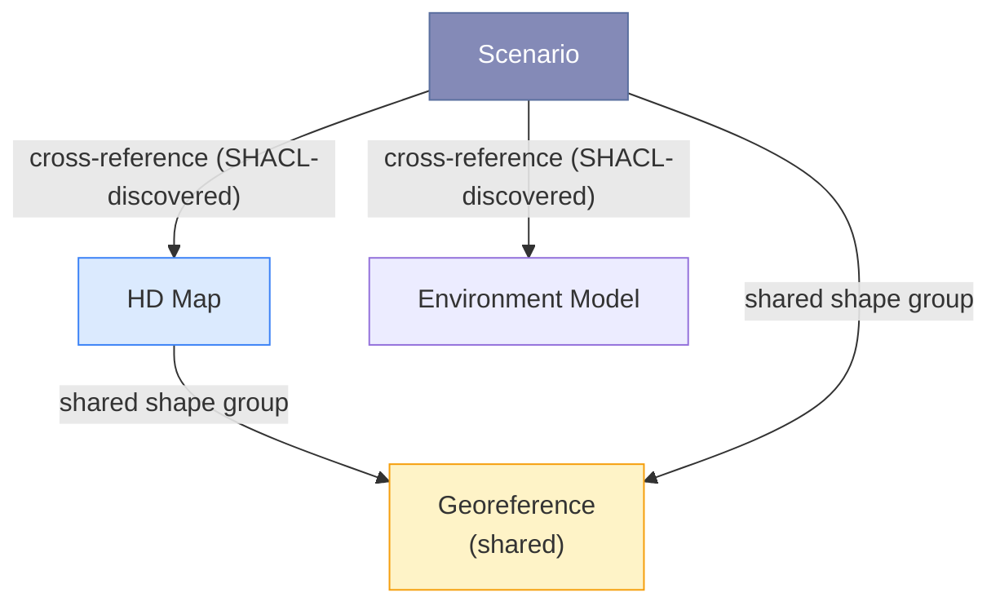

# Ontology Model

The system is **ontology-agnostic**: it works with any OWL + SHACL ontology and
discovers everything it needs at startup. The ENVITED-X simulation-asset
ontologies are the **demonstration** ontology used throughout these docs as the
running example — no production code path is specific to them (see
[Generic Design](/generic-design)).

## What is an Ontology?

In this context, an **ontology** is a formal description of the types, properties, and relationships of the assets being searched. It defines:

- **What types of assets exist** (in the demo: HD maps, scenarios, environment models, …)
- **What properties they have** (road types, lane counts, formats, countries, …)
- **What values are allowed** (e.g. road types must be one of: motorway, urban, rural, …)
- **How they relate to each other** (e.g. a scenario references an HD map)

An ontology in this system uses two W3C standards:

| Standard                               | Role                             | What it defines (demo example)                                          |
| -------------------------------------- | -------------------------------- | ----------------------------------------------------------------------- |
| **OWL** (Web Ontology Language)        | Class and property definitions   | "An HdMap has properties roadTypes, laneCount, formatType"              |
| **SHACL** (Shapes Constraint Language) | Value constraints and validation | "roadTypes must be one of: motorway, urban, rural, interstate, highway" |

## Domain Structure

The system does not assume any particular asset structure — it walks whatever
SHACL property paths the loaded ontology declares. The demo ENVITED-X ontologies
happen to give each asset type its own **domain ontology** following a consistent
pattern (shown below); a different ontology with a flatter or deeper shape would
work without code changes:



In the demo ontology this pattern is uniform across all domains, but uniformity is not required — the system discovers properties and values automatically from the SHACL shapes regardless of how they are organized.

## Vocabulary Extraction

The system does **not** use a manually maintained vocabulary. Instead, at startup:



### Example: How `sh:in` becomes vocabulary

The ontology defines allowed road types like this:

```turtle
hdmap:RoadTypesPropertyShape a sh:PropertyShape ;
  sh:path hdmap:roadTypes ;
  sh:in ("motorway" "urban" "rural" "interstate" "highway"
         "country-road" "pedestrian" "bicycle" "parking" "ramp") .
```

The vocabulary extractor runs a SPARQL query against the schema graph:

```sparql
SELECT ?property ?value ?domain WHERE {
  GRAPH <urn:graph:schema> {
    ?shape sh:path ?property ;
           sh:in/rdf:rest*/rdf:first ?value .
    ?parentShape sh:property ?shape .
  }
}
```

This produces a structured `OntologyVocabulary` that the prompt builder and slot validator consume — **fully automatically, no manual mapping required**.

### Why not SKOS?

An earlier design used manually maintained SKOS vocabularies as an intermediate layer. This was replaced because:

| SKOS approach                              | Direct OWL+SHACL approach               |
| ------------------------------------------ | --------------------------------------- |
| Manual maintenance per ontology change     | Automatic extraction at startup         |
| Risk of vocabulary drift                   | Always in sync with ontology            |
| Concept matcher with fuzzy string matching | LLM handles synonym resolution natively |
| Extra layer of indirection                 | Simpler, fewer moving parts             |

## Supported Domains

With the demo ENVITED-X ontologies loaded, the registry discovers **~20 domains** from the ontology source, of which **5 asset domains** carry sample instance data — **358 assets** in total — and the vocabulary domain `openlabel` carries **44 standalone tags** (`sample-openlabel.jsonld`):

| Domain                | Instance Assets | Key Properties                                                          |
| --------------------- | :-------------: | ----------------------------------------------------------------------- |
| **HD Map**            |       165       | roadTypes, laneCount, speedLimit, formatType, country, trafficDirection |
| **Environment Model** |       70        | terrainType, vegetationType, weatherCondition                           |
| **OSI Trace**         |       53        | roadTypes, granularity, fileFormat, numberFrames                        |
| **Scenario**          |       50        | scenarioCategory, weather, timeOfDay, trafficDensity                    |
| **Surface Model**     |       20        | materialType, frictionCoefficient, textureFormat                        |

Exact counts track the sample data files and may shift as they evolve (re-measured against OMB 0.5.0 on the branch that added the standalone OpenLABEL tags: counts above unchanged). The standalone tags (see [Data](/data#openlabel-sample-data)) come on top of the asset counts, and the HD-map and scenario assets additionally carry OpenLABEL V1-0-0 content nodes. The remaining discovered domains ship SHACL shapes without sample instances (for example automotive-simulator, simulation-model, simulated-sensor, and vv-report).

## OpenLABEL: v1 vs. v2

OMB ships two OpenLABEL domains. They are **not** two versions of one model, and only v1 is what the ENVITED-X asset shapes reference:

|                       | `openlabel` — **V1-0-0**                                                                                                                     | `openlabel-v2` — **WIP**                                                                      |
| --------------------- | -------------------------------------------------------------------------------------------------------------------------------------------- | --------------------------------------------------------------------------------------------- |
| Namespace             | `https://openlabel.asam.net/V1-0-0/ontologies/` (ASAM's)                                                                                     | `https://w3id.org/ascs-ev/envited-x/openlabel/v2/` (ASCS-eV's)                                |
| Source of truth       | ASAM's OWL, verbatim, plus **hand-authored** SHACL and JSON-LD context                                                                       | one LinkML model (`linkml/openlabel-v2/openlabel-v2.yaml`) that generates OWL, SHACL, context |
| Referenced by         | HD-map (`OddScenery`) and scenario (`OddEnvironment`, `OddDynamicElements`, `Behaviour`, `RoadUser`) shapes                                  | no asset shape                                                                                |
| Properties in the OWL | none — flags and enumeration values are **classes** in a taxonomy (`MotorwayManaged ⊑ RoadTypeMotorway ⊑ DrivableAreaType ⊑ … ⊑ OddScenery`) | declared object/datatype properties, enumerations as named individuals                        |

What was checked in OMB (`artifacts/openlabel`, `submodules/asam-openx-standards/standards/asam-openlabel`):

- **The OWL is ASAM's.** `openlabel.owl.ttl` and ASAM's `openlabel_ontology_scenario_tags.ttl` have the same 243 classes and identical superclasses. They declare no properties; the SHACL paths (`openlabel:HorizontalStraights`, `openlabel:motionDriveValue`, …) are OMB's integration layer, which OMB itself calls "not an official ASAM deliverable".
- **There is no model that generates v1.** SHACL (9 node shapes, 107 property paths, 17 flag↔value `sh:sparql` rules plus one `minValue ≤ maxValue` rule) and context (≈280 hand-written terms with per-term `xsd:boolean` / `xsd:decimal` / `@type: @vocab` coercions) are maintained by hand next to the OWL.
- **ASAM's JSON schema describes something else.** `openlabel_json_schema*.json` (draft-07, 46 definitions) defines the annotation _file_ — `openlabel.tags[*]` is `{ontology_uid, type, tag_data}`, next to frames, objects, actions and events. It contains none of the ODD vocabulary (no `DrivableAreaType`, no `MotionDrive`, …), so it cannot validate the RDF representation. In v1 the SHACL shapes are the only machine-checkable contract, and that is what the sample data is validated against.

Shape properties of v1 that matter for search and data (found while building the sample data):

- The category shapes `OddSceneryShape`, `OddEnvironmentShape` and `OddDynamicElementsShape` have **no properties**; all 61 ODD properties sit on `OddShape` (target `Odd`), which category nodes reach through the class hierarchy. The `sh:or` unions of the HD-map and scenario shapes are therefore vacuous: SHACL cannot tell that scenery belongs in an HD map and weather in a scenario. The sample data follows OMB's own valid instances instead (category-pure nodes), and the compiler does not assume the split: a leaf inherited from `OddShape` binds a content node of its own, so a filter on weather and one on traffic match the separate environment and dynamic-element nodes.
- Some `*Value` properties are `sh:or ( scalar  schema:QuantitativeValue )` (speed, lane count, dimensions, accelerate, decelerate, drive); others are a plain decimal or integer. An `xsd:integer` is not an `xsd:decimal` ([SHACL] §4.1.2 compares datatype IRIs), which is why integers are only valid where the shape says integer.
- `AdminTagShape` declares its properties as `sh:datatype rdfs:Literal`. `rdfs:Literal` is a class, not the datatype of any literal, so a strict engine can never accept a value (pyshacl special-cases it); the evident intent is `sh:nodeKind sh:Literal`.
- `RoadUserShape` carries a stray copy of `motionDriveValue`.
- **Scalar-or-range value properties are searched by their scalar values.** A property shape whose `sh:or` has a member with an `sh:datatype` is a literal leaf ([SHACL] §4.6.3), and a range property when every member datatype is numeric, so ranges on speed, lane count, dimensions and the motion values compare the recorded numbers. A value recorded as a `schema:QuantitativeValue` range node is not matched: range discovery reads an `sh:node` declared on the property shape itself and an `sh:lessThanOrEquals` between the bound properties ([SHACL] §4.5.4), while v1 reaches `QuantitativeValueShape` through an `sh:or` member and orders the bounds with an `sh:sparql` rule. An `sh:or` whose members are all `sh:in` lists (the 4 enumeration unions in v2) is an enumerated leaf whose values are the union of the lists.

### Choosing which OpenLABEL the search loads

Both domains are loaded by default, which gives the model two near-identical vocabulary names to choose from ("OpenLABEL only" is ambiguous, and `openlabel-v2` has standalone entry classes but no data). The per-source `excludeDomains` denylist of `ontology-sources.json` scopes this without touching code:

```json
{
  "sources": [
    {
      "name": "omb-artifacts",
      "path": ".ontology/artifacts",
      "excludeDomains": ["openlabel-v2"]
    }
  ]
}
```

(every domain of the pinned OMB except `openlabel-v2`, which is left out until it is finished and referenced by the asset shapes; with this manifest `openlabel-v2` is no longer in the domain registry and the OpenLABEL test suites pass unchanged).

To search **OpenLABEL V1-0-0 only**, whitelist it instead. The schema graph, the LLM prompt, the domain registry and the asset domains then contain `openlabel` alone, so every query targets `openlabel:Tag` and the results are the 44 standalone OpenLABEL documents of the sample data (the OpenLABEL nodes embedded in HD-map and scenario assets are not returned, because those asset ontologies are not loaded):

```json
{
  "sources": [{ "name": "omb-artifacts", "path": ".ontology/artifacts", "domains": ["openlabel"] }]
}
```

## Cross-Domain Relationships

Domains reference each other through SHACL property paths. The compiler discovers these cross-references at runtime — no predicate name is hardcoded in production code:



At warmup, `reference-index.ts` BFSes every typed asset instance and records each outgoing reference as a `(sourceClass, predicatePath, targetClass)` signature. The compiler uses these signatures to emit JOINs, and the per-row traceability breadcrumb under each result renders the actual predicate path that connected the two assets.

When a user searches for "scenarios on German motorways", the compiler generates a SPARQL query that joins scenario assets with their referenced HD map's georeference shape group. Broader queries can stay multi-domain as well: because `roadTypes` exists in both HD map and OSI trace ontologies, a search like "German motorway assets" can match both domains without hardcoded domain tables.

## Ontology Sources & the `imports/` Opt-In

The stack loads its artifacts from the roots declared in `ontology-sources.json`
(validated by `ontology-sources.schema.json`, JSON Schema 2020-12), or in the
manifest `ONTOLOGY_SOURCES_FILE` points at. Without a manifest it falls back to
`ONTOLOGY_ARTIFACTS_PATH`, then to the pinned `.ontology/artifacts` cache.
Multiple roots are supported, each with an optional per-root domain selection
(see [Selecting ontologies](#selecting-ontologies)).

### Selecting ontologies

Each source can restrict which of its domain subdirectories (= ontologies) are
loaded:

| key              | meaning                                                       |
| ---------------- | ------------------------------------------------------------- |
| `domains`        | whitelist — load **only** these domains of the root           |
| `excludeDomains` | blacklist — never load these domains; applied after `domains` |

A domain left out by the selection is invisible to the whole stack: it is not
loaded into the schema graph, not part of the domain registry, the SHACL
validator, the term index's JSON-LD contexts or the LLM prompt, and can
therefore never be searched or returned. Only the data loader still reads its
JSON-LD context, to parse instance data that uses it. Naming a domain in both lists is rejected at startup
(`OntologySourcesError`); a name that matches no subdirectory is logged as a
warning (`unknownDomains`), since it is almost always a typo. The selection
needs a restart of the API to take effect.

A domain is loaded when it is in `domains` (or `domains` is omitted) **and** it
is not in `excludeDomains`. Domain names are the subdirectory names of the
source root, e.g. `ls .ontology/artifacts`. `ontology-sources.json` is
gitignored, so each checkout picks its own selection. Start from
`ontology-sources.example.json`:

```bash
cp ontology-sources.example.json ontology-sources.json
```

Then add a selection to the source:

| goal                              | source entry                                                                  |
| --------------------------------- | ----------------------------------------------------------------------------- |
| search OpenLABEL V1-0-0 only      | `{ "path": ".ontology/artifacts", "domains": ["openlabel"] }`                 |
| search HD maps and scenarios only | `{ "path": ".ontology/artifacts", "domains": ["hdmap", "scenario"] }`         |
| everything except `openlabel-v2`  | `{ "path": ".ontology/artifacts", "excludeDomains": ["openlabel-v2"] }`       |
| everything except Gaia-X and V2   | `{ "path": ".ontology/artifacts", "excludeDomains": ["gx", "openlabel-v2"] }` |

The selection is not transitive. If you leave out an ontology that an asset
ontology builds on, the asset ontology and its data still load, but the
properties it gets from the left-out ontology can't be searched. For example,
with `"domains": ["hdmap"]` all 165 HD maps load, but only the 23 `hdmap`
properties are searchable. `country` and `city` come from `georeference`, so
add that domain to filter by location.

To check the active selection after a restart, call `/stats`.
`availableDomains` and the per-domain asset counts list only the selected
domains:

```bash
curl -s http://localhost:3003/stats
# {"totalAssets":44,"domains":{"openlabel":44},"availableDomains":["openlabel"],…}
```

Before starting, `pnpm run check:setup` prints how many shape files the
selection loads, and fails if it loads none. The API reports unknown domain
names and overlapping lists when it starts.

OMB also ships `imports/` — the foundation vocabularies its ontologies build on
(`cred`, `cs`, `dcterms`, `did`, `foaf`, `org`, `owl`, `prov`, `rdf`, `rdfs`,
`schema`, `sec`, `sh`, `skos`, `xsd` as per-directory `*.owl.ttl`). These are
**not loaded by default**, and measurement shows loading them is safe but buys
nothing for search today:

| metric                              | artifacts only | + `imports/` |
| ----------------------------------- | -------------- | ------------ |
| schema-graph triples                | 254,415        | 315,347      |
| term cards / distinct leaf IRIs     | 936 / 524      | not measured |
| value-hierarchy edges in the schema | 9,390          | 10,895       |
| asset domains / ref. edges          | 13 / 469       | 13 / 469     |
| retrieval recall (gating set)       | 1.00           | 1.00         |

The first three rows are measured against OMB 0.5.0 (the last two are from an earlier measurement); the term cards with `imports/` are not measured. Term cards include the leaves of standalone vocabulary entry classes — `openlabel` 105, `openlabel-v2` 108, `gx` 80, `envited-x` 19, `manifest` 15, `general` 4 — and 249 leaves the asset domains reach only through inheritance below the asset class or an `sh:or` member (`hdmap` and `scenario` 76 each, `service` 61, `automotive-simulator`, `leakage-test`, `simulation-model` and `vv-report` 9 each); without them the index has 356 cards.

Searchable vocabulary is SHACL-driven and `imports/` ships no `*.shacl.ttl`,
so no phantom domains or meta-vocabulary properties can appear — no filter
layer is required. The only growth is foundation `rdfs:subClassOf` edges, the
1,505 extra edges above. They reach a query only as narrower values of an
IRI-valued filter, which the compiler lists from the schema graph
(`value-hierarchy.ts`); nothing is written into the instance data.

**To opt in** (e.g. when foundation class hierarchies become load-bearing),
add a second source to `ontology-sources.json`:

```json
{
  "sources": [
    { "name": "omb-artifacts", "path": ".ontology/artifacts" },
    { "name": "omb-imports", "path": ".ontology/imports" }
  ]
}
```

No code change is involved; the loader, term index, retrieval, and compiler
are root-agnostic by construction. `OpenDrive`/`OpenScenario` under `imports/`
contain only XSD schemas (no RDF) and cannot be loaded.

## Using your own ontology

Any OWL + SHACL ontology can replace the demo one, including a private one
that must not be referenced from this repository. Nothing about it is
committed here: the manifest, artifacts and instance data all live next to
your ontology, and a single git-ignored setting points the stack at them.

### Prerequisites

- **Artifacts in the per-domain layout** the loader discovers:
  `<root>/<domain>/<domain>.shacl.ttl`, plus optional `<domain>.owl.ttl` and
  `<domain>.context.jsonld`. Tools that generate an
  [OMB](https://github.com/ASCS-eV/ontology-management-base)-style bundle
  (e.g. LinkML `gen-owl` / `gen-shacl` / `gen-jsonld-context` per module)
  produce exactly this.
- **SHACL node shapes** with `sh:targetClass` in the domain's namespace; nested
  structure via `sh:node` or `sh:class`; enumerations via `sh:in`. The
  searchable vocabulary is derived from these shapes alone.
- **Instance data** (JSON-LD or Turtle) whose asset nodes are typed with the
  root class. `rdfs:label` is used as the display name when present; it is not
  required (closed shapes cannot carry it).

### Configure

1. Write a manifest next to your ontology checkout. Relative paths resolve
   against the manifest's own directory; absolute paths are used as-is.

   ```json
   {
     "sources": [
       {
         "name": "module-a",
         "path": "build/artifacts",
         "domains": ["module-a", "module-b"],
         "data": "examples/search-data"
       }
     ]
   }
   ```

   - `domains` — list the per-module bundles and leave out an umbrella bundle
     that re-declares every module's shapes, or those shapes load twice.
   - `data` — once any source declares it, the built-in demo data is not
     loaded.
   - `name` — on a source that declares `data`, a `name` equal to one of the
     loaded domain directories makes that domain searchable as an asset
     domain, provided its shapes declare a target class, even when no
     `rdfs:subClassOf` hierarchy marks it as one. Any other `name` is a label
     only.

2. Point the stack at it in `.env.local` (git-ignored):

   ```bash
   ONTOLOGY_SOURCES_FILE=../my-ontology/ontology-sources.json
   ```

3. Verify and start:

   ```bash
   pnpm run check:setup     # counts the shape files the manifest resolves to
   pnpm run build && pnpm run --filter @ontology-search/api start
   curl localhost:3003/stats        # asset counts per discovered domain
   curl localhost:3003/vocabulary   # searchable properties + sh:in values
   ```

The pinned OMB distribution is still fetched on `pnpm install`; the authoring
features use its `imports/`, search does not.

### Instance data notes

- **Remote `@context`.** A context IRI is resolved offline against the
  `*.context.jsonld` files of the source's `path`, matched by their `@vocab`
  / `@base`. All of its domains count, including those `domains` leaves out,
  so data may use an umbrella bundle's context; where two contexts claim the
  same IRI, a selected domain's wins. The catalog form
  `<ontology-iri>/context` (or `#context`) matches the context whose `@vocab`
  is that namespace, `<ontology-iri>/` (or `<ontology-iri>#`).
- **Relative IRIs** in Turtle files — schema and instance data alike —
  resolve against the file's location ([TURTLE] §6.3), so generator output
  without `@base` still loads, and the schema graph, the domain registry and
  the SHACL validator all see the same IRIs. A relative `@id` in JSON-LD data
  resolves against the file's location too ([JSON-LD11] §4.1.3), unless the
  document's own context sets `@base`.
- **Validate before loading.** OMB's suite checks data against the same
  bundle:

  ```bash
  python -m omb.validators.validation_suite --run check-data-conformance \
    --data-paths <data-dir> --artifacts <artifacts-root> --inference-mode rdfs
  ```

  Give nested objects an explicit `@type` when their properties carry no
  `rdfs:range` in the OWL (class-scoped attributes), and type literals whose
  term has no datatype coercion in the context
  (`{"@value": "120.0", "@type": "xsd:float"}`), or RDFS inference cannot type
  them and `sh:class` / `sh:datatype` constraints fail.

### Property keys: one leaf name, several paths

Filters are keyed by a **property key**, one per predicate chain
([ADR 0009](https://github.com/ASCS-eV/ontology-based-nl-search/blob/main/docs/adr/0009-per-path-property-keys.md)).
A leaf the domain reaches one way is keyed by its local name. Ontologies that
wrap categorical properties in value objects sharing one leaf
(`colour → ColourValue → value`, `size → SizeValue → value`) reach that leaf
several ways, and each chain gets a qualified key: the shortest suffix of its
predicate local names that no other chain shares, joined with `__`
(`colour__value`, `size__value`). A chain no suffix tells apart — one step long,
or the tail of another — is led by its owning class (`Asset__description`).

Each qualified key carries its own chain's `sh:in`, labels that include the
qualifying predicates, and its own card, so "red cars" and "small cars" map to
different keys. The bare name (`value`) stays a key and matches any chain that
can hold the value: those whose own `sh:in` contains it, and those that declare
none. Check the keys a domain resolves with `curl localhost:3003/vocabulary`.

The same holds for one class used in several places. When the asset reaches a
class by several routes (a behaviour class under the ego and under every other
road user, say), each route is a different sequence path from the asset
([SHACL](https://www.w3.org/TR/shacl/#property-path-sequence) §2.3.1.2), so
each leaf of the class gets one key per route
(`intended__lane_maneuver__maneuver_type__code`,
`users__lane_maneuver__maneuver_type__code`) and the bare name matches every
route. Bare names filtered together that sit on the same class and reach it by
the same routes (a latitude and a longitude) are matched on one node of each
route, not the latitude of one point with the longitude of another. Routes
whose predicates have the same
local names count once, since no key could tell them apart, and at most four
routes per class are kept, so reused classes cannot multiply the keys without
bound; a class with more logs a warning at startup. A domain's own shape-group
properties keep their one route, since the meta-model places them on one node
per group, and below the entry class of a standalone vocabulary only the
shortest route is searched.
