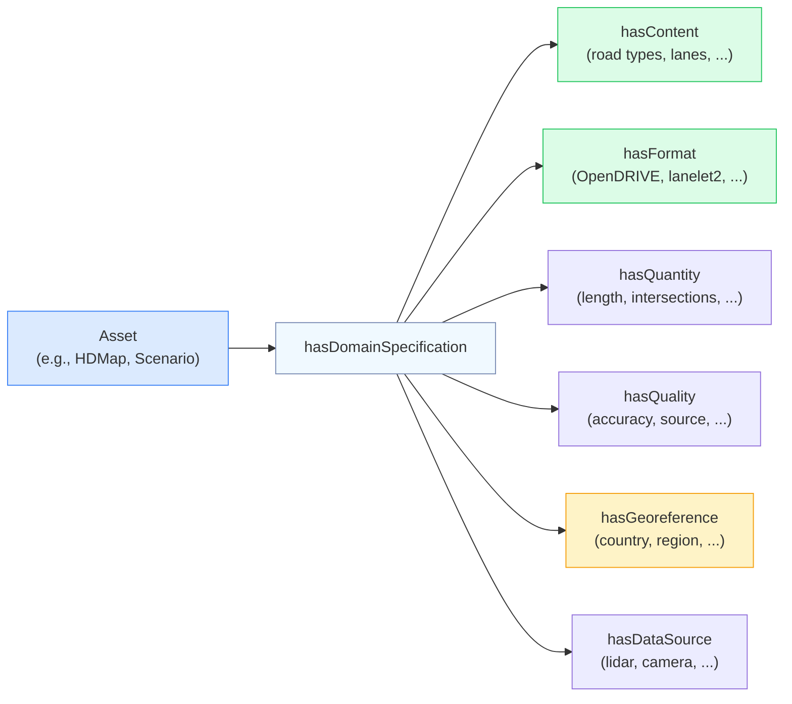
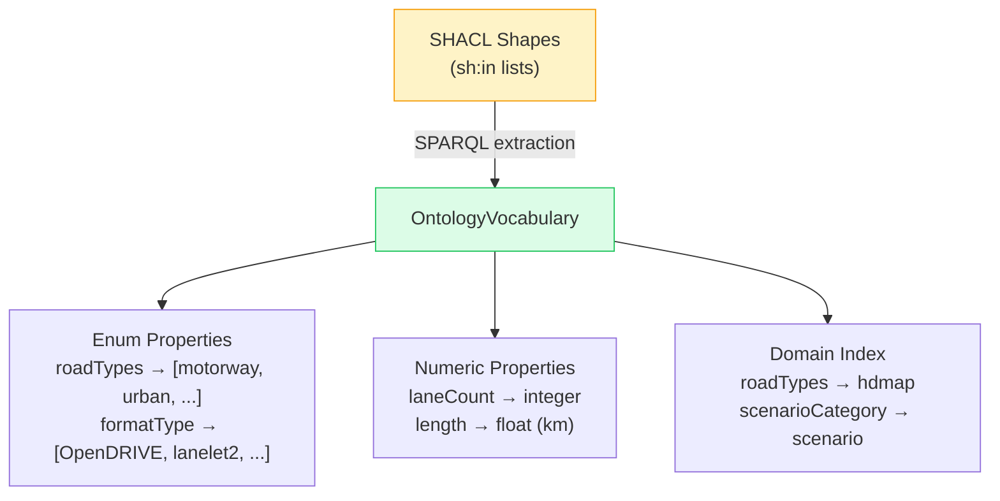
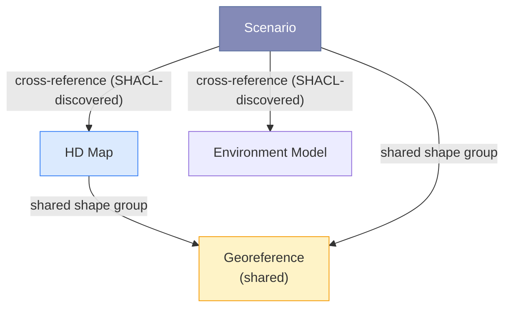

# Ontology Model

The system is **ontology-agnostic**: it works with any OWL + SHACL ontology and
discovers everything it needs at startup. The ENVITED-X simulation-asset
ontologies are the **demonstration** ontology used throughout these docs as the
running example — no production code path is specific to them (see
[Generic Design](/generic-design)).

## What is an Ontology?

In this context, an **ontology** is a formal description of the types, properties, and relationships of the assets being searched. It defines:

- **What types of assets exist** (in the demo: HD maps, scenarios, environment models, …)
- **What properties they have** (road types, lane counts, formats, countries, …)
- **What values are allowed** (e.g. road types must be one of: motorway, urban, rural, …)
- **How they relate to each other** (e.g. a scenario references an HD map)

An ontology in this system uses two W3C standards:

| Standard                               | Role                             | What it defines (demo example)                                          |
| -------------------------------------- | -------------------------------- | ----------------------------------------------------------------------- |
| **OWL** (Web Ontology Language)        | Class and property definitions   | "An HdMap has properties roadTypes, laneCount, formatType"              |
| **SHACL** (Shapes Constraint Language) | Value constraints and validation | "roadTypes must be one of: motorway, urban, rural, interstate, highway" |

## Domain Structure

The system does not assume any particular asset structure — it walks whatever
SHACL property paths the loaded ontology declares. The demo ENVITED-X ontologies
happen to give each asset type its own **domain ontology** following a consistent
pattern (shown below); a different ontology with a flatter or deeper shape would
work without code changes:



In the demo ontology this pattern is uniform across all domains, but uniformity is not required — the system discovers properties and values automatically from the SHACL shapes regardless of how they are organized.

## Vocabulary Extraction

The system does **not** use a manually maintained vocabulary. Instead, at startup:



### Example: How `sh:in` becomes vocabulary

The ontology defines allowed road types like this:

```turtle
hdmap:RoadTypesPropertyShape a sh:PropertyShape ;
  sh:path hdmap:roadTypes ;
  sh:in ("motorway" "urban" "rural" "interstate" "highway"
         "country-road" "pedestrian" "bicycle" "parking" "ramp") .
```

The vocabulary extractor runs a SPARQL query against the schema graph:

```sparql
SELECT ?property ?value ?domain WHERE {
  GRAPH <urn:graph:schema> {
    ?shape sh:path ?property ;
           sh:in/rdf:rest*/rdf:first ?value .
    ?parentShape sh:property ?shape .
  }
}
```

This produces a structured `OntologyVocabulary` that the prompt builder and slot validator consume — **fully automatically, no manual mapping required**.

### Why not SKOS?

An earlier design used manually maintained SKOS vocabularies as an intermediate layer. This was replaced because:

| SKOS approach                              | Direct OWL+SHACL approach               |
| ------------------------------------------ | --------------------------------------- |
| Manual maintenance per ontology change     | Automatic extraction at startup         |
| Risk of vocabulary drift                   | Always in sync with ontology            |
| Concept matcher with fuzzy string matching | LLM handles synonym resolution natively |
| Extra layer of indirection                 | Simpler, fewer moving parts             |

## Supported Domains

With the demo ENVITED-X ontologies loaded, the registry discovers **~20 domains** from the ontology source, of which **5 populated domains** carry sample instance data — **358 assets** in total:

| Domain                | Instance Assets | Key Properties                                                          |
| --------------------- | :-------------: | ----------------------------------------------------------------------- |
| **HD Map**            |       165       | roadTypes, laneCount, speedLimit, formatType, country, trafficDirection |
| **Environment Model** |       70        | terrainType, vegetationType, weatherCondition                           |
| **OSI Trace**         |       53        | roadTypes, granularity, fileFormat, numberFrames                        |
| **Scenario**          |       50        | scenarioCategory, weather, timeOfDay, trafficDensity                    |
| **Surface Model**     |       20        | materialType, frictionCoefficient, textureFormat                        |

Exact counts track the sample TTL files and may shift as they evolve. The standalone OpenLABEL tags (`sample-openlabel.jsonld`, see [Data](/data#openlabel-sample-data)) come on top of these asset counts, and the HD-map and scenario assets additionally carry OpenLABEL V1-0-0 content nodes. The remaining discovered domains ship SHACL shapes without sample instances (for example automotive-simulator, simulation-model, simulated-sensor, and vv-report).

## OpenLABEL: v1 vs. v2

OMB ships two OpenLABEL domains. They are **not** two versions of one model, and only v1 is what the ENVITED-X asset shapes reference:

|                       | `openlabel` — **V1-0-0**                                                                                                                     | `openlabel-v2` — **WIP**                                                                      |
| --------------------- | -------------------------------------------------------------------------------------------------------------------------------------------- | --------------------------------------------------------------------------------------------- |
| Namespace             | `https://openlabel.asam.net/V1-0-0/ontologies/` (ASAM's)                                                                                     | `https://w3id.org/ascs-ev/envited-x/openlabel/v2/` (ASCS-eV's)                                |
| Source of truth       | ASAM's OWL, verbatim, plus **hand-authored** SHACL and JSON-LD context                                                                       | one LinkML model (`linkml/openlabel-v2/openlabel-v2.yaml`) that generates OWL, SHACL, context |
| Referenced by         | HD-map (`OddScenery`) and scenario (`OddEnvironment`, `OddDynamicElements`, `Behaviour`, `RoadUser`) shapes                                  | no asset shape                                                                                |
| Properties in the OWL | none — flags and enumeration values are **classes** in a taxonomy (`MotorwayManaged ⊑ RoadTypeMotorway ⊑ DrivableAreaType ⊑ … ⊑ OddScenery`) | declared object/datatype properties, enumerations as named individuals                        |

What was checked in OMB (`artifacts/openlabel`, `submodules/asam-openx-standards/standards/asam-openlabel`):

- **The OWL is ASAM's.** `openlabel.owl.ttl` and ASAM's `openlabel_ontology_scenario_tags.ttl` have the same 243 classes and identical superclasses. They declare no properties; the SHACL paths (`openlabel:HorizontalStraights`, `openlabel:motionDriveValue`, …) are OMB's integration layer, which OMB itself calls "not an official ASAM deliverable".
- **There is no model that generates v1.** SHACL (9 node shapes, 107 property paths, 17 flag↔value `sh:sparql` rules plus one `minValue ≤ maxValue` rule) and context (≈280 hand-written terms with per-term `xsd:boolean` / `xsd:decimal` / `@type: @vocab` coercions) are maintained by hand next to the OWL.
- **ASAM's JSON schema describes something else.** `openlabel_json_schema*.json` (draft-07, 46 definitions) defines the annotation _file_ — `openlabel.tags[*]` is `{ontology_uid, type, tag_data}`, next to frames, objects, actions and events. It contains none of the ODD vocabulary (no `DrivableAreaType`, no `MotionDrive`, …), so it cannot validate the RDF representation. In v1 the SHACL shapes are the only machine-checkable contract, and that is what the sample data is validated against.

Shape properties of v1 that matter for search and data (found while building the sample data):

- The category shapes `OddSceneryShape`, `OddEnvironmentShape` and `OddDynamicElementsShape` have **no properties**; all 61 ODD properties sit on `OddShape` (target `Odd`), which category nodes reach through the class hierarchy. The `sh:or` unions of the HD-map and scenario shapes are therefore vacuous: SHACL cannot tell that scenery belongs in an HD map and weather in a scenario. The sample data follows OMB's own valid instances instead (category-pure nodes), and the compiler must not assume the split.
- Some `*Value` properties are `sh:or ( scalar  schema:QuantitativeValue )` (speed, lane count, dimensions, accelerate, decelerate, drive); others are a plain decimal or integer. An `xsd:integer` is not an `xsd:decimal` ([SHACL] §4.1.2 compares datatype IRIs), which is why integers are only valid where the shape says integer.
- `AdminTagShape` declares its properties as `sh:datatype rdfs:Literal`. `rdfs:Literal` is a class, not the datatype of any literal, so a strict engine can never accept a value (pyshacl special-cases it); the evident intent is `sh:nodeKind sh:Literal`.
- `RoadUserShape` carries a stray copy of `motionDriveValue`.
- **Path discovery skips property shapes with `sh:or`** (`queryLeafProperties`). In v1 that hides the scalar-or-range value properties above, so ranges on speed, lane count, dimensions and the three motion values cannot be searched; the same holds for the 16 literal-or-`QuantitativeValue` unions and 4 enumeration unions in v2 and for many `gx` shapes. Range filters on scalar-only value properties (`weatherRainValue`, `horizontalCurvesValue`, `trafficVolumeValue`, …) work.

### Choosing which OpenLABEL the search loads

Both domains are loaded by default, which gives the model two near-identical vocabulary names to choose from ("OpenLABEL only" is ambiguous, and `openlabel-v2` has standalone entry classes but no data). The per-source `domains` allowlist of `ontology-sources.json` scopes this without touching code:

```json
{
  "sources": [
    {
      "name": "omb-artifacts",
      "path": ".ontology/artifacts",
      "domains": [
        "automotive-simulator",
        "description",
        "environment-model",
        "envited-x",
        "example",
        "general",
        "georeference",
        "gx",
        "hdmap",
        "leakage-test",
        "manifest",
        "openlabel",
        "ositrace",
        "scenario",
        "service",
        "simulated-sensor",
        "simulation-model",
        "surface-model",
        "survey",
        "tzip21",
        "vv-report"
      ]
    }
  ]
}
```

(every domain of the pinned OMB 0.5.0 except `openlabel-v2`, which is left out until it is finished and referenced by the asset shapes; with this manifest `openlabel-v2` is no longer in the domain registry and the OpenLABEL test suites pass unchanged).

## Cross-Domain Relationships

Domains reference each other through SHACL property paths. The compiler discovers these cross-references at runtime — no predicate name is hardcoded in production code:



At warmup, `reference-index.ts` BFSes every typed asset instance and records each outgoing reference as a `(sourceClass, predicatePath, targetClass)` signature. The compiler uses these signatures to emit JOINs, and the per-row traceability breadcrumb under each result renders the actual predicate path that connected the two assets.

When a user searches for "scenarios on German motorways", the compiler generates a SPARQL query that joins scenario assets with their referenced HD map's georeference shape group. Broader queries can stay multi-domain as well: because `roadTypes` exists in both HD map and OSI trace ontologies, a search like "German motorway assets" can match both domains without hardcoded domain tables.

## Ontology Sources & the `imports/` Opt-In

The stack loads its artifacts from the roots declared in `ontology-sources.json`
(validated by `ontology-sources.schema.json`, JSON Schema 2020-12). Without a
manifest it falls back to `ONTOLOGY_ARTIFACTS_PATH`, then to the default
submodule path. Multiple roots are supported, each with an optional per-root
`domains` allowlist.

OMB also ships `imports/` — the foundation vocabularies its ontologies build on
(`cred`, `cs`, `dcterms`, `did`, `foaf`, `org`, `owl`, `prov`, `rdf`, `rdfs`,
`schema`, `sec`, `sh`, `skos`, `xsd` as per-directory `*.owl.ttl`). These are
**not loaded by default**, and measurement shows loading them is safe but buys
nothing for search today:

| metric                        | artifacts only | + `imports/` |
| ----------------------------- | -------------- | ------------ |
| schema-graph triples          | 248,135        | 272,287      |
| term cards / searchable props | 483 / 165      | 483 / 165    |
| asset domains / ref. edges    | 13 / 469       | 13 / 469     |
| retrieval recall (gating set) | 1.00           | 1.00         |

Searchable vocabulary is SHACL-driven and `imports/` ships no `*.shacl.ttl`,
so no phantom domains or meta-vocabulary properties can appear — no filter
layer is required. The only growth is foundation `rdfs:subClassOf` edges,
which nothing on the search path consumes yet.

**To opt in** (e.g. when foundation class hierarchies become load-bearing),
add a second source to `ontology-sources.json`:

```json
{
  "sources": [
    { "name": "omb-artifacts", "path": ".ontology/artifacts" },
    { "name": "omb-imports", "path": ".ontology/imports" }
  ]
}
```

No code change is involved; the loader, term index, retrieval, and compiler
are root-agnostic by construction. `OpenDrive`/`OpenScenario` under `imports/`
contain only XSD schemas (no RDF) and cannot be loaded.
