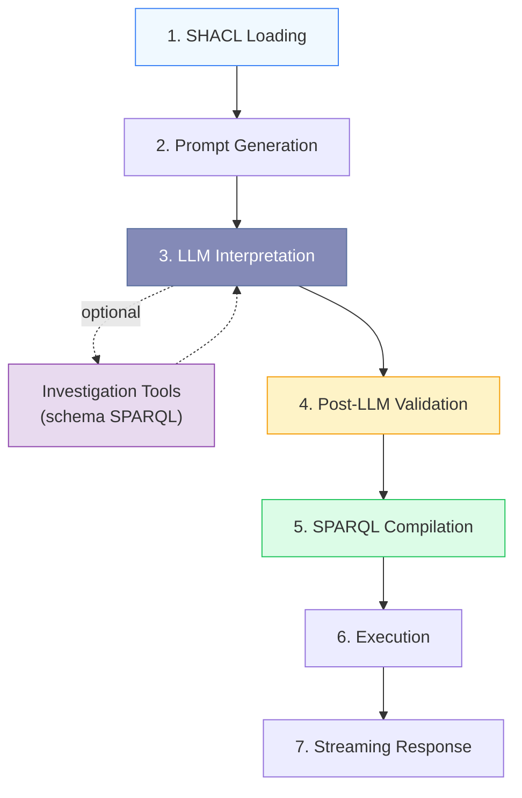
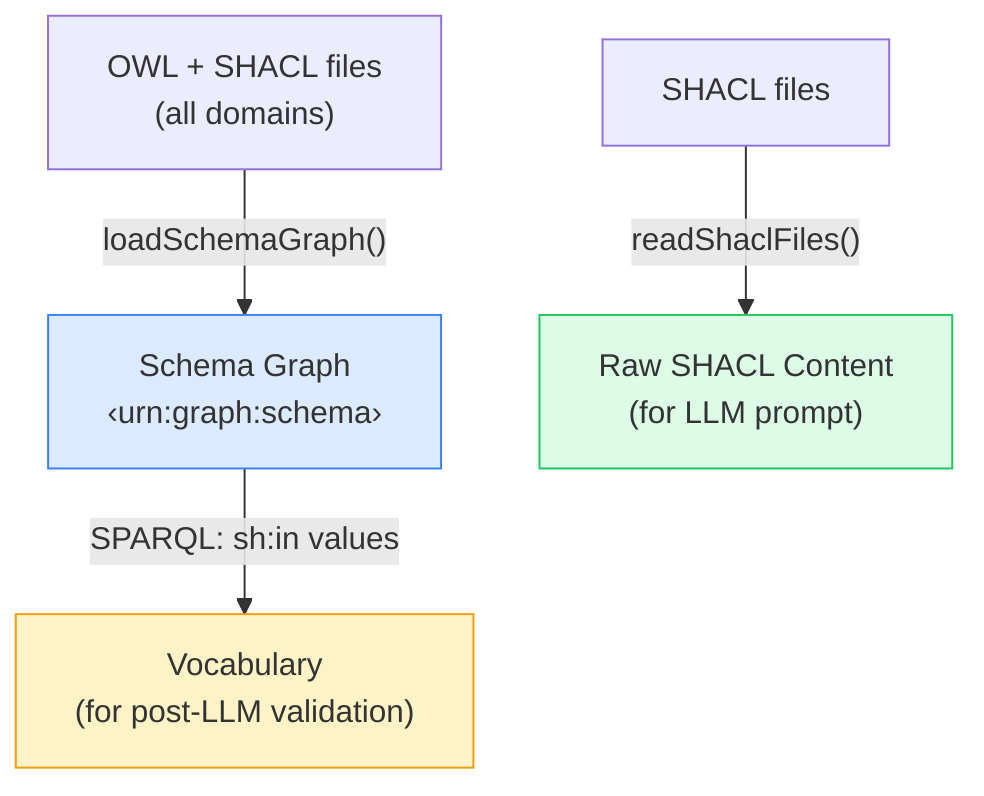
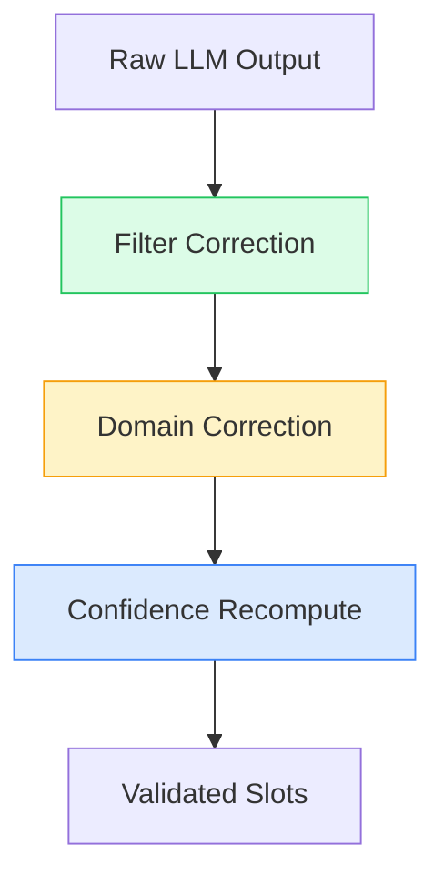

# Query Flow

From "motorway maps in Germany" to SPARQL results — step by step.

## Pipeline Stages



## Stage 1: SHACL Loading (startup)

At startup, the **schema loader** reads all OWL + SHACL files into a named graph (`<urn:graph:schema>`). In parallel, the **SHACL reader** extracts raw `.shacl.ttl` content for the LLM prompt:



**Output:** Raw SHACL Turtle for prompt injection + `OntologyVocabulary` for validation + schema graph for compiler queries.

## Stage 2: Prompt Generation

The **prompt builder** embeds the raw SHACL Turtle content directly into the system prompt, organized by domain:

- Raw Turtle shapes per domain in fenced code blocks (the LLM reads `sh:in`, `sh:pattern`, `sh:datatype`, `sh:description` natively)
- Guidance for geography and license filters (kept in the generic `filters` map, not as dedicated slots)
- Synonym resolution rules ("YOU are the synonym resolver")
- Few-shot examples with expected `submit_slots` tool-call output

The prompt is generated once at startup and cached. When the ontology changes, the prompt updates automatically.

## Stage 3: LLM Interpretation

The LLM agent receives the user query + generated prompt and calls `submit_slots`:

```json
{
  "slots": {
    "domains": ["hdmap"],
    "filters": { "roadTypes": ["motorway"], "country": ["DE"] },
    "ranges": { "laneCount": { "min": 3 } },
    "references": [{ "domain": "ositrace" }]
  },
  "interpretation": "German motorway HD maps with at least 3 lanes; cross-referenced to OSI traces",
  "gaps": [{ "term": "ADAS testing", "reason": "Not a defined ontology property" }]
}
```

The LLM resolves natural-language synonyms ("highway" → "motorway", "German" → "DE") grounded by the raw SHACL shapes. There are no top-level `location` or `license` slots: country, region, city and license all flow through the same `filters` map, keyed by SHACL leaf local name. The optional `references` slot is a **list** of cross-domain JOINs, each bound to a SHACL-discovered asset class; they are AND-combined, so an asset must reference _all_ listed domains to match. Each entry may itself nest `references` to express a **chain** (scenario → trace → map) rather than flat siblings (scenario → trace AND scenario → map). A single object is still accepted and normalized to a one-element list for backward compatibility.

The agent is configured with `toolChoice: { type: 'tool', toolName: 'submit_slots' }` — the LLM commits on step 1. Investigation tools remain available but are rarely needed because the full SHACL is already in the prompt.

## Stage 4: Post-LLM Validation

The **slot validator** applies three corrections to catch LLM mistakes:



| Correction                   | What it does                                                                          | Example                                                                   |
| ---------------------------- | ------------------------------------------------------------------------------------- | ------------------------------------------------------------------------- |
| **Filter correction**        | Fuzzy-matches values against `sh:in` vocabulary                                       | `"Motorway"` → `"motorway"`, `"hihgway"` → `"highway"`                    |
| **Domain correction**        | Uses a property → `Set<domain>` map to preserve valid choices and add missing domains | LLM chose `["scenario"]` for "scenarios on motorways" → merges in `hdmap` |
| **Confidence recomputation** | Removes LLM bias from confidence scores                                               | Exact `sh:in` match = high, edit-distance match = medium                  |
| **Gap enrichment**           | Adds suggestions from real vocabulary for gaps                                        | `"ADAS testing"` → suggests `"free-driving"`, `"following"`               |

## Stage 5: SPARQL Compilation

The compiler uses **property paths** discovered from SHACL (not hardcoded predicates) and builds `CompilerVocab` from schema graph queries. It turns validated `SearchSlots` into deterministic SPARQL:

```sparql
PREFIX rdfs: <http://www.w3.org/2000/01/rdf-schema#>
PREFIX hdmap: <https://w3id.org/ascs-ev/envited-x/hdmap/v6/>
PREFIX georeference: <https://w3id.org/ascs-ev/envited-x/georeference/v5/>

SELECT ?asset ?name ?roadTypes ?country WHERE {
  ?asset a hdmap:HdMap ;
    rdfs:label ?name .
  ?asset hdmap:hasDomainSpecification ?domSpec .
  ?domSpec hdmap:hasContent ?content .
  ?content hdmap:roadTypes ?roadTypes .
  ?domSpec hdmap:hasGeoreference ?georef .
  ?georef georeference:hasProjectLocation ?loc .
  ?loc georeference:country ?country .
  FILTER(?roadTypes = "motorway")
  FILTER(CONTAINS(LCASE(STR(?country)), "de"))
}
```

**Key properties:**

- ✅ **Deterministic** — same slots always produce the same query
- ✅ **Ontology-agnostic** — predicate chains discovered from SHACL, not hardcoded
- ✅ **W3C-compliant** — `STR()` wrapping handles both literal and IRI-valued nodes
- ✅ **Cross-domain** — referenced domains only join when they carry active filters that the referencing domain does not already carry; when a referenced domain's constraints are all shared with its parent (e.g. the same vocabulary leaf reachable from both), the domains are peers and each gets its own `UNION` arm, so no requested domain is dropped
- ✅ **Standalone vocabularies** — a request scoped only to a support vocabulary (e.g. "OpenLABEL only") resolves to the asset domains whose discovered paths use that vocabulary **plus** the vocabulary itself — but only those that can express **every** restriction the vocabulary defines (an HD map carries scenery attributes, never a behaviour flag, so "straight motorway **and** lane keeping" is not answered by it). The vocabulary's entry classes are discovered from SHACL (classes of a non-asset domain that own properties but are never the value of a `sh:node`/`sh:class` nesting); each yields an extra `UNION` arm `?asset a <root>` guarded by `FILTER NOT EXISTS { ?_owner ?_ownerLink ?asset }`, so only unattached documents of that vocabulary match, never ones nested inside an asset. A standalone document is a closed unit: an entry class that has no path for one of the restrictions yields **no** arm (rather than dropping the restriction), and when no arm can answer the query the result is an explicit `FILTER(false)` — never an empty group, which would be one unbound row ([SPARQL11] §5.2.1). A standalone document references nothing, so with a reference (explicit, or the JOIN a parent→child hierarchy compiles to) the vocabulary contributes no arm and the asset domains compile as they would without it
- ✅ **Syntax-validated** — post-compilation validation catches structural errors
- ✅ **Honest result counts** — the query is ordered by asset and bounded by a single `LIMIT SPARQL_MAX_LIMIT` ([SPARQL11] §15.1, §15.5). `matchCount` is the number of distinct matching assets; if the bound was reached the trailing asset's rows are dropped, so every asset returned carries its complete set of joined rows and `meta.truncated` marks the count as a lower bound for the UI to render as `N+`
- ✅ **Datatype-aware literals** — the comparison for a literal follows the leaf's `sh:datatype` ([SHACL] §4.1.2), never the look of the value. A leaf declared `xsd:boolean` is compared by lexical form (`STR(?v) IN ("true", "1")`; both lexical forms of each value, [RDF11] §5) because `"true"^^xsd:boolean` is never RDF-term-equal to the simple literal `"true"` ([SPARQL11] §17.4.1.7); every other literal keeps plain equality
- ✅ **Scope has two readings** — in natural language, a support vocabulary named next to an asset domain is the model's _inference_ and is dropped (a named asset domain is never broadened). In an explicit request — refine or GraphQL — the selection is the user's own, so every domain given, vocabulary included, is compiled. Both are pinned by tests

## Stage 6: Execution

SPARQL runs against the in-memory **Oxigraph** store:

- Instance data in the default graph; schema in `<urn:graph:schema>`
- Sub-millisecond query execution for most queries
- Supports both Oxigraph WASM (dev/test) and remote Fuseki (production)

## Stage 7: Streaming Response

Results are sent as **Server-Sent Events** (SSE) — the UI updates progressively:

| Event            | Payload                           | When                       |
| ---------------- | --------------------------------- | -------------------------- |
| `status`         | `{ phase: "interpreting" }`       | Pipeline starts            |
| `interpretation` | `{ summary, mappedTerms[] }`      | LLM interpretation ready   |
| `gaps`           | `[{ term, reason, suggestions }]` | Unmatched terms identified |
| `sparql`         | `"SELECT ..."`                    | Query compiled             |
| `status`         | `{ phase: "executing" }`          | Execution starts           |
| `results`        | `{ results: [...] }`              | Query results              |
| `meta`           | `{ matchCount, executionTimeMs }` | Timing stats               |
| `done`           | `{}`                              | Pipeline complete          |

`matchCount` is the number of **distinct primary assets**, not result rows — a cross-reference JOIN fans out to one row per referenced asset, so the UI groups rows by `?asset` and the count reflects assets (rows ≥ matches). When the query contains a reference JOIN, the `results` payload also carries a per-row, per-reference `traceability` breadcrumb.

Users see the interpretation immediately while SPARQL execution happens in the background — perceived latency is dramatically reduced.

## After the search: the gap log

The `gaps` event tells the person who searched which parts of the query did not become a filter. The **gap log** tells the people who maintain the ontology the same thing, counted across searches, so they can decide what to model next from what users actually asked for.

It is off by default. Set `FEATURE_GAP_LOG=true` and the search service counts every search's gaps per term; `GET /gaps` returns them, most reported first:

```json
{
  "capacity": 1000,
  "entries": [
    {
      "term": "potholes",
      "count": 12,
      "kinds": { "unmapped": 12 },
      "domains": ["hdmap"],
      "firstSeen": "2026-09-28",
      "lastSeen": "2026-09-29"
    }
  ]
}
```

What an entry holds is fixed, not configurable: the normalized term (Unicode NFKC, invisible characters removed, whitespace collapsed, lower-cased), the number of searches that reported it, its gap kinds, the domains those searches were scoped to (referenced domains included), and the first and last day it was seen. It never holds the query, a user, a session or a request id, and dates are kept at day precision as RFC 3339 `full-date`s (the JSON Schema 2020-12 `date` format).

What is not recorded:

- terms longer than 80 characters, and a term that is the whole query;
- searches the model did not interpret (no slots were submitted, so the only gap is the query itself);
- `limitation` gaps, which report an engine limit on a concept the ontology has, not a missing concept;
- more than 10 terms from one search.

The log is in memory and bounded at 1,000 distinct terms. A new term replaces the least reported one (the one seen longest ago among equals), so a stream of one-off terms cannot push out the terms that recur.

Because it records fragments of what people typed, turning it on is a deployment decision. Check data protection first, and, in organisations that have one, the works council. Set `GAP_LOG_API_KEY` so that only the ontology's maintainers can read `/gaps`: with it set, `/gaps` accepts that key and not the search `API_KEY`, and in production the API refuses to start with the log on and no maintainer key. While the log is on, `/stats` reports `features.gapLog: true` and the search UI tells people, under their gaps, that unmapped terms are counted.

Not every gap is a missing concept. A term can be a synonym of an existing value, a value missing from an `sh:in` list, a concept the ontology already has but no asset carries, a misreading by the model, or out of scope. The log is a queue of leads for the ontology's maintainers to check, not a list of changes to apply.
